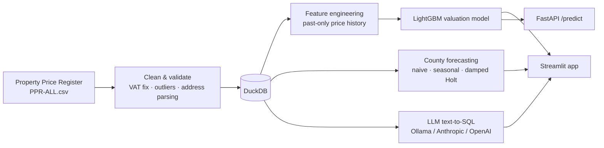

# 🏠 Irish Housing Market Intelligence

**An end-to-end machine-learning platform built on every residential property sale in Ireland since 2010.**

It cleans and validates **756,540 sales** from the Property Price Register, values any property with an
explainable LightGBM model, forecasts county prices 12 months ahead, and lets you ask questions in plain English
through a guarded LLM text-to-SQL assistant, all in one Streamlit app with a FastAPI service.


---

## Highlights

| | Result |
|---|---|
| 📊 **Data** | 756,540 cleaned sales (2010–2026) from 809,014 raw records |
| 🎯 **Valuation model** | **12.8% median error** on 56,062 unseen sales, vs 25.0% for a county baseline |
| 📈 **Explained variance** | R² (log price) **0.596**, vs 0.264 for the baseline |
| ✅ **Accuracy band** | **41.6%** of valuations within 10% of the sale price, about **2×** the baseline (21.1%) |
| 🔮 **Forecasting** | 5.5% mean backtest error across all 26 counties |
| 🤖 **LLM assistant** | **95%** execution accuracy (19/20) on a gold-SQL benchmark, running locally on Ollama |

## Screenshots

| Market overview | Price estimator with SHAP |
|---|---|
|  |  |

| County forecasts | Ask the data (LLM) |
|---|---|
|  |  |

## What it does

| Page | Description |
|---|---|
| **Market overview** | National price and volume trends, county comparisons, biggest movers, Dublin postal-district league table |
| **Price estimator** | Values a property at today's market level, explains the estimate with SHAP, shows comparable recent sales. An optional address unlocks the home's own sale history and its street's price trend |
| **Forecasts** | 12-month forecast per county with 80% intervals; the model is chosen per county by backtest |
| **Ask the data** | Plain-English questions → SQL → answer, with read-only guardrails, automatic self-correction and visible SQL |
| **Model card** | Test metrics against baselines, feature importance, error by county, LLM benchmark results, limitations |

## Architecture



## Results

Evaluated on a **strict time-based hold-out**: trained on sales up to September 2025 (700,478 sales), tested on
the following 12 months (October 2025 – September 2026, **56,062 sales the model never saw**).

| Model | Median error | Median abs. error | Within 10% | R² (log) | MAE |
|---|---|---|---|---|---|
| Baseline: county median | 25.0% | €95,000 | 21.1% | 0.264 | €153,585 |
| Baseline: county × market index | 27.0% | €103,721 | 19.0% | 0.261 | €157,478 |
| **LightGBM (this project)** | **12.8%** | **€49,525** | **41.6%** | **0.596** | **€93,964** |

Homes that had sold before (24% of the test set) are valued at 13.0% median error with R² 0.65.

**Most important features** (mean |SHAP|): estate price level, last sale on the same street, recent estate
prices, county, town, named house (no number), recent street prices, new build.

## Method

### 1. Data cleaning
- Decodes the Windows-1252 source file and parses `€` prices.
- Adds back 13.5% VAT for new builds reported ex-VAT.
- Removes *Not Full Market Price* sales, prices outside €30k–€5m, and duplicates.
- Extracts the **town**, **Dublin postal district**, **Eircode routing key** and an **apartment** flag from free-text addresses.
- Data-quality checks gate the pipeline: it stops if any check fails.

### 2. Valuation model
- **Target:** `log(price ÷ national market index)`, where the index is the median of the *previous* three
  months. Tree models can't extrapolate rising prices; predicting a property's level *relative to the market*
  solves this without using future information.
- **Price-history features**, all computed only from sales on **earlier days** than the one being valued:
  - the previous sale of the same home (repeat sales);
  - the street's overall, latest and recent (last 5 sale days) price level;
  - the estate's overall and recent price level.

  Sales are aggregated per day first, so same-day bulk deals never see each other.
- **Address-text features:** named houses with no number (often one-off rural homes), street type, address detail.
- **Training:** L1 loss (optimises the typical error and is robust to outlier sales), recent years weighted
  more heavily, early stopping on the last 12 months of the training window.
- **Leakage audit:** for 600 random test sales, every history feature was independently recomputed from
  strictly earlier sales and matched exactly.
- **Explainability:** exact TreeSHAP values from LightGBM for every prediction.

### 3. Forecasting
For each county, three models are backtested on the last 12 months: naive, seasonal naive with drift, and damped
Holt (exponential smoothing). The best one is refit and used, with 80% intervals sized from its backtest error.

### 4. LLM text-to-SQL
- Schema-grounded prompt with few-shot examples of common question types (year-over-year change, trends, shares).
- **Guardrails:** single `SELECT`/`WITH` statement only; file, network and DDL keywords blocked; read-only
  database connection; row limit.
- **Self-correction:** if a query fails, or returns an implausible result (empty, all-NULL, all-zero), the
  model gets the error back and retries, up to twice. If it still looks wrong, the app shows a warning rather
  than a confident answer.
- **Evaluation:** a gold-SQL benchmark compares query *results*, not SQL text (`python -m src.llm.evaluate`).

## Quick start

Requires **Python 3.10+**.

```bash
git clone https://github.com/sahilichake/irish-housing-intelligence.git
cd irish-housing-intelligence
python -m venv .venv
source .venv/bin/activate          # Windows: .venv\Scripts\activate
pip install -r requirements.txt

python -m src.pipeline             # download data, clean, train, forecast (~5 min)
streamlit run app/streamlit_app.py
```

**If the automatic download fails:** download *PPR-ALL.zip* from
[propertypriceregister.ie](https://www.propertypriceregister.ie), place it in `data/raw/`, and rerun the pipeline.

**Offline test:** `python -m src.pipeline --sample` builds everything on *synthetic* data in seconds.

### LLM setup (for "Ask the data")
Copy `.env.example` to `.env` and choose a provider:

| Provider | Setup |
|---|---|
| **Ollama** (free, local) | Install [Ollama](https://ollama.com), run `ollama pull qwen2.5-coder:7b`, set `LLM_PROVIDER=ollama` |
| Anthropic | Set `LLM_PROVIDER=anthropic` and `ANTHROPIC_API_KEY` |
| OpenAI | Set `LLM_PROVIDER=openai` and `OPENAI_API_KEY` |

### Other commands
```bash
uvicorn api.main:app --reload      # REST API, docs at http://127.0.0.1:8000/docs
pytest -q                          # tests
python -m src.llm.evaluate         # LLM benchmark
docker build -t irish-housing . && docker run -p 8501:8501 irish-housing
```

Example API call:
```bash
curl -X POST http://127.0.0.1:8000/predict -H "Content-Type: application/json" \
  -d '{"county": "Dublin", "town": "Lucan", "is_apartment": false, "address": "10 Example Park, Lucan"}'
```

## Project structure

```
├── app/streamlit_app.py      # Streamlit UI (5 pages)
├── api/main.py               # FastAPI service
├── src/
│   ├── pipeline.py           # end-to-end runner
│   ├── config.py             # paths, constants, .env loading
│   ├── data/                 # download, cleaning & validation, DuckDB, synthetic sample
│   ├── models/               # features, price model, prediction, forecasting
│   └── llm/                  # text-to-SQL with guardrails, evaluation benchmark
├── tests/                    # cleaning, SQL guardrails, model & API tests
└── .github/workflows/ci.yml  # tests on every push, monthly retrain on fresh data
```

## Limitations and next steps

- The register has **no floor area, bedrooms, bathrooms or condition** for most sales, so the model values
  location, type and price history, not the specific house.
- Apartment status and street/estate are inferred from free-text addresses, which are inconsistently written.
- **Next:** geocode addresses (distance to city centre, DART/Luas, schools), join CSO census small-area
  statistics and RTB rents, and add BER energy ratings.

## Data and licence

Property Price Register data © Property Services Regulatory Authority (PSRA), used under its published terms.
This project is for research and education; its outputs are **not** formal valuations or financial advice.

---

**Author:** Sahil Ichake · [LinkedIn](https://linkedin.com/in/sahil-ichake) · [GitHub](https://github.com/sahilichake)
